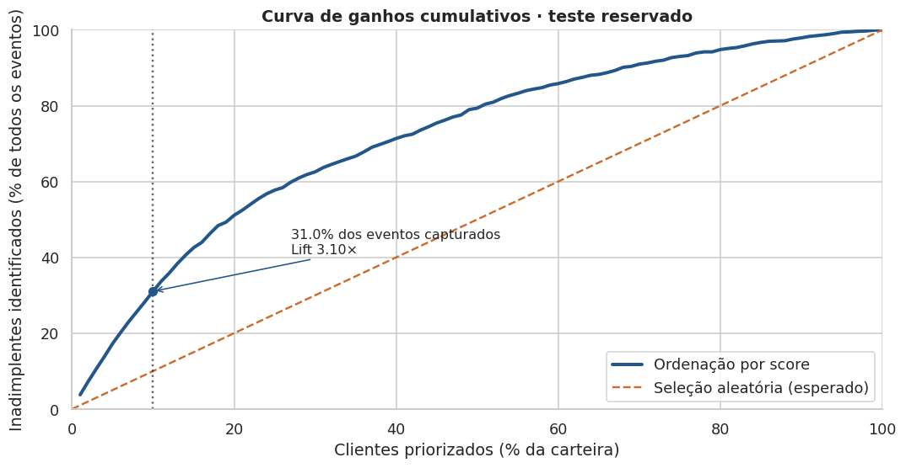
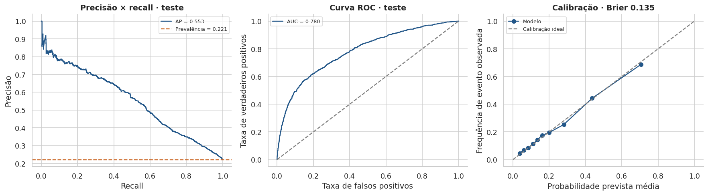
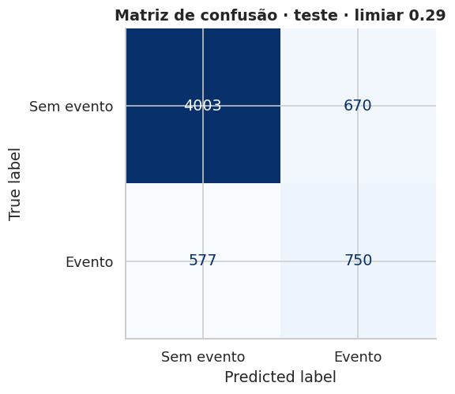
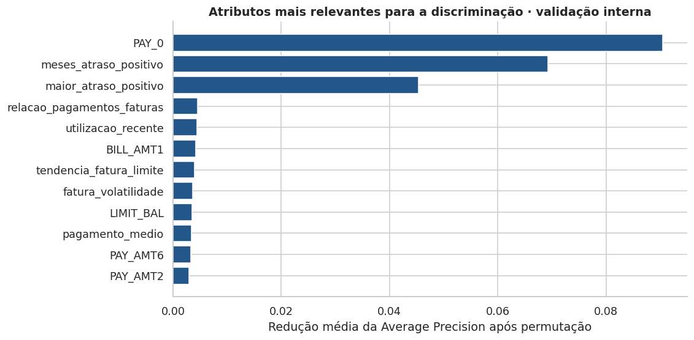

# Credit Risk Intelligence: Modelagem e Priorização de Inadimplência

[](https://www.python.org/)
[](LICENSE)
[](https://doi.org/10.24432/C55S3H)
[-green.svg)](https://archive.ics.uci.edu/dataset/350/default+of+credit+card+clients)

> **Como priorizar a análise de uma carteira de crédito com dados históricos e validação rigorosa?**  
> Estudo acadêmico de Ciência de Dados e Estatística conduzido por **Felipe Alirio Baruja** (Graduando em Estatística e Ciência de Dados na USP/ICMC).  
> *Aviso: Os dados utilizados são históricos (Taiwan, 2005) e a finalidade é estritamente de pesquisa metodológica. Não aplicável diretamente a políticas reais de concessão de crédito.*

---

## 1. Visão Geral e Problema Operacional

Em instituições financeiras e mesas de crédito, a capacidade humana de auditoria ou contato preventivo é limitada (ex.: revisar 10% dos clientes de maior risco da carteira). Em vez de classificar com limiares arbitrários, o objetivo deste estudo é modelar o risco de crédito e ordenar a carteira de forma a **maximizar a concentração de eventos de inadimplência no topo do ranking**.

### Características do Estudo
- **Base Histórica:** 30.000 clientes da base UCI *Default of Credit Card Clients* (Taiwan, 2005).
- **Partição sem vazamento:** 80% treino e validação cruzada (24.000 clientes) e 20% teste reservado (6.000 clientes), com estratificação pela taxa de inadimplência (22,12%).
- **Atributos:** 23 preditores originais expandidos para **28 atributos financeiros** após engenharia de comportamento (atrasos, volatilidade de fatura, consumo de limite e razão de pagamentos).
- **Governança de Dados Ética:** Exclusão proposital de todos os atributos demográficos (`SEX`, `EDUCATION`, `MARRIAGE`, `AGE`) do pipeline final.

---

## 2. Métricas no Teste Reservado (6.000 clientes, 1.327 eventos)

| Métrica | Resultado Reproduzido | Referência / Baseline | Interpretação |
| :--- | :---: | :---: | :--- |
| **Average Precision (AP)** | **0,555** (IC 0,530–0,582) | 0,221 (prevalência) | Superioridade consistente no ordenamento de precisão sobre a taxa base. |
| **ROC-AUC** | **0,780** (IC 0,766–0,795) | 0,500 (aleatório) | Alta capacidade discriminativa global entre adimplentes e inadimplentes. |
| **Clientes no Top 10%** | **600** clientes | 10% da carteira | Simulação de corte por restrição de capacidade operacional. |
| **Inadimplentes no Top 10%** | **415** eventos | 133 eventos (aleatório) | Concentração de **31,3% de todos os inadimplentes** da carteira. |
| **Precision@10%** | **69,2%** (IC 65,3–72,3%) | 22,1% (taxa base) | 7 em cada 10 casos priorizados apresentaram inadimplência real. |
| **Lift@10%** | **3,13×** (IC 2,95–3,27×) | 1,00× (sem modelo) | Triplica a eficiência da alocação de esforço da mesa de análise. |
| **Brier Score** | **0,135** | 0,172 (referência) | Avaliação de calibração probabilística do score. |

---

## 3. Evidências Gráficas

### 3.1 Curva de Ganhos Cumulativos e Priorização Operacional
Ao inspecionar os 10% com maior pontuação de risco, a esteira captura mais de 31% de todas as ocorrências de default, gerando um lift de **3,13×** contra a triagem aleatória:



### 3.2 Curvas de Precisão-Recall (PR) e ROC
Avaliação estrita da discriminação no teste reservado independente:



### 3.3 Matriz de Confusão no Limiar OOF Calibrado ($\tau = 0,26$)
O limiar foi calibrado exclusivamente via previsões *Out-of-Fold* no treino, sem tocar nos dados de teste:



### 3.4 Importância de Atributos por Permutação
O histórico recente de atrasos de pagamento (`PAY_0`, `maior_atraso_positivo`, `PAY_2`) lidera o impacto preditivo:



---

## 4. Como Reproduzir

### Instalação
```bash
git clone https://github.com/BarujaFe1/credit-risk-intelligence.git
cd credit-risk-intelligence
python3 -m venv .venv
source .venv/bin/activate
pip install -r requirements.txt
```

### Execução Automatizada
```bash
python run_reproduction.py
```
O script baixará os dados diretamente da UCI (via `ucimlrepo`), executará os pipelines de validação cruzada, o teste reservado e salvará todos os artefatos em `results/`. Tempo estimado: ~2 minutos.

### Testes de Integridade
```bash
pytest -v tests/
```

---

## 5. Limitações e Responsabilidade

1. **Escopo Acadêmico:** Desenvolvido como projeto de estudo estatístico e aprendizado de máquina no ICMC-USP. Não foi homologado para decisões automáticas de concessão bancária.
2. **Contexto Geográfico/Temporal:** Dados coletados em Taiwan em 2005. O comportamento de inadimplência não é diretamente transferível para a realidade brasileira contemporânea sem calibração local e variáveis macroeconômicas.
3. **Custos Assimétricos:** A escolha de limiar por $F_1$-score não substitui uma matriz de perdas e ganhos financeiramente calibrada.
4. **Variações Estocásticas:** Variações marginais de ponto flutuante podem ocorrer entre versões do `scikit-learn` (documentadas no [Guia de Reprodução](docs/REPRODUCIBILITY.md)).

---

## 6. Documentação Detalhada
- [Auditoria Metodológica e Prevenção de Vazamento](docs/NOTEBOOK_AUDIT.md)
- [Guia de Reprodução Independente](docs/REPRODUCIBILITY.md)
- [Data Card](docs/DATA_CARD.md)
- [Model Card](docs/MODEL_CARD.md)
- [Limitações Éticas e Técnicas](docs/LIMITATIONS.md)

---

## 7. Citação e Dados
```bibtex
@misc{yeh2016default,
  author       = {Yeh, I-Cheng},
  title        = {{Default of Credit Card Clients}},
  year         = {2016},
  howpublished = {UCI Machine Learning Repository},
  doi          = {10.24432/C55S3H}
}
```
